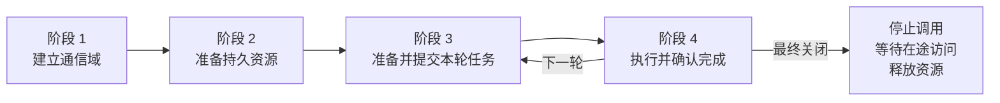
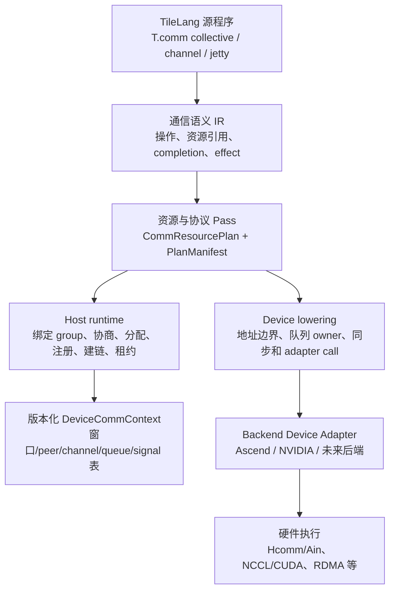

# TileLang 多后端通信编程范式设计

> 状态：设计提案  
> 目标：在 TileLang 中建立可扩展的通信编程语义，使同一份程序能够表达高阶集合通信、点对点窗口通信和队列/批量通信，并由不同后端分别映射到 Ascend、NVIDIA 以及后续设备。  

> 实现进展：已实现 `T.comm.*` 和高阶 collective 的同步 Host 原型；其余接口仍为设计。

## 1. 问题定义与设计目标

通信算子的难点不在于把一个函数名映射成某个后端函数，而在于同时处理四件事：

1. 参与通信的 rank、设备和控制面如何确定；
2. 远端可访问的内存、端点、Channel、队列和信号如何准备并复用；
3. 当前调用如何把本地计算结果发布给通信引擎，并建立跨 stream、跨设备的依赖；
4. 何时能消费结果、覆盖槽位、释放 Tensor 引用和销毁资源。

Ascend 文档中的 HCCL/URMA Channel 路径和 NVIDIA 文档中的 CUDA IPC/P2P、NCCL、RDMA 路径使用的硬件接口不同，但都遵循相同的生命周期。TileLang 应将这个生命周期和通信正确性定义在公共语义层，将拓扑、内存注册、队列提交、设备同步等差异封装在后端适配层。

本文的目标是：

- 以四阶段生命周期作为所有后端共享的顶层契约；
- 在 TileLang 中提供三种层次的编程模式：高阶 collective、P2P、P2MP；
- 让通信资源在编译期以计划声明，在 Host runtime 中按真实 group 和设备实例化；
- 让设备代码只看到版本化、可验证、设备可访问的描述符，不把 Host 对象或 CPU 指针传入 Kernel；
- 用 capability 和 adapter 隔离 Ascend、NVIDIA 以及未来后端的差异；
- 让通信和 TileLang 既有的 tile、流水、布局、stream 依赖可以组合。

首版不要求所有后端提供相同的性能或硬件能力。后端缺少某项能力时，编译期或准备阶段应明确拒绝对应模式，或者选择一个已验证的替代算法。

## 2. 从两种硬件实现抽象出的共同模型

### 2.1 四阶段生命周期



| 阶段 | 公共语义 | Ascend 例子 | NVIDIA 例子 | TileLang 产物 |
| --- | --- | --- | --- | --- |
| 1. 建立通信域 | 确定 group 成员、group-local rank、设备、控制面和 backend | torch_npu ProcessGroup、HcclComm | ProcessGroup、NCCL communicator 或控制组 | `CommContext` 的身份和 bootstrap 入口 |
| 2. 准备持久资源 | 分配/注册窗口，交换远端描述符，建立连接和设备表 | HCCL Engine Context、注册 GM、UB_CTP Channel、远端窗口 | cudaMalloc、CUDA IPC handle、P2P 映射、NCCL 连接或 RDMA | `CommResourcePlan` 的实例化、`DeviceCommContext` |
| 3. 准备并提交本轮任务 | 校验本轮 shape/dtype，发布输入，建立 stream 依赖，选择算法，提交工作 | Tensor→send window、AIV launch、传入 Channel 和状态 | Tensor→staging、当前 CUDA stream、kernel/NCCL task | call generation、lease、stage launch、completion token |
| 4. 执行并确认完成 | 传输/归约完成，结果可读，源和槽位何时可复用 | Hcomm Init→ReadNbi/WriteNbi→Drain，ready/consumed | kernel/P2P、NCCL collective、CUDA event/barrier | effect graph、ready/acquire、drain/release、异步引用释放 |

阶段边界必须是可检查的契约：

- 阶段 2 结束：所有声明的持久资源已创建，设备描述符已发布；
- 阶段 3 结束：当前任务和依赖已入队，输入引用仍被 lease 持有；
- 阶段 4 结束：输出满足消费条件，所有需要远端读取的源区域满足复用条件；
- 最终关闭：没有在途的 device、transport、signal 或远端访问。

创建 ProcessGroup、建立远端可达性、完成本轮数据同步是三件不同的事。TileLang 不应因为拿到了外部 group 就假定 Kernel 可以直接解引用远端 Tensor。

### 2.2 三类控制对象

通信实现中至少有三种对象，公共 API 应明确区分：

| 对象 | 所在层 | 作用 | 是否传入 Device |
| --- | --- | --- | --- |
| `CommContext` | Python/Host runtime | 持有 group、backend、缓存、能力、生命周期 | 不传 Host 地址 |
| `CommResource` | Host + 设备资源 | 窗口注册、Channel、endpoint、queue、远端凭证 | 以描述符形式 |
| `DeviceCommContext` | 设备 GM | rank、peer 表、窗口偏移、句柄槽位、signal 和状态 | 传入指针 |

外部 ProcessGroup/HcclComm/NCCL communicator 是 Host 控制面对象。它们不能被当成普通 kernel 参数，也不能让 device code 解释 CPU 虚拟地址。设备代码只访问 adapter 定义的 ABI。

## 3. TileLang 的分层架构



公共层和后端层职责如下：

| 层 | 应定义什么 | 不应依赖什么 |
| --- | --- | --- |
| 语言层 | collective、put/get、commit/drain、notify/wait、rank/size | 具体 Hcomm/NCCL 函数名 |
| 语义 IR | 资源引用、地址范围、完成 token、读写效果、rank scope | 某一设备的 SQE 布局 |
| 资源规划 | 窗口/槽位/信号/队列容量和生命周期 | 运行时裸指针 |
| Host runtime | group 绑定、全 rank 协商、注册、远端描述符、缓存和回收 | 设备 kernel 内部线程组织 |
| Device lowering | 描述符索引、64 位地址计算、owner 映射、内存顺序 | CPU API 或 Host 对象 |
| Backend adapter | 能力查询、资源创建、设备调用、错误翻译 | 公共 DSL 语义的重新定义 |

## 4. 公共通信对象与语义

### 4.1 通信域作用域与 Host 隐式资源初始化

PyTorch 侧完成通信域创建，得到通信域group对象（process_group），Tilelang框架负责将此通信域与语言层进行绑定、持有资源，并通过`scope`、`T.comm.current` 建立映射。  

样例：  

```python
import tilelang
import tilelang.language as T


def make_allreduce(N):
    @T.prim_func
    def kernel(
        x: T.Tensor((N,), "float32"),
        y: T.Tensor((N,), "float32"),
    ):
        ctx = T.comm.current()  # 编译期语义对象，不增加公开函数参数
        T.comm.all_reduce(ctx, x, y, op="sum")

    return kernel


N = 4096
compiled_op = tilelang.compile(
    make_allreduce(N),
    target="cuda",              # Ascend 使用对应 target，源语义可复用
    execution_backend="tvm_ffi",
    out_idx=1,
)

# process_group 已由应用创建；各 rank 使用一致的通信实例 namespace。
with tilelang.comm.scope(
    group=process_group,
    device=device,
    backend="auto",
    namespace="model/layer0/tp",
):
    y = compiled_op(x)          # 首次：初始化资源，再执行
    y = compiled_op(x_next)     # 后续：查缓存并复用资源
# 退出 scope：按契约等待在途使用，释放该 scope 自有资源。
```
`tileang.comm.scope(group, ...)` 通信域与语言层进行绑定、持有资源。  
`T.comm.current()` 在编译时表示“此 Kernel 使用当前 Host 调用的通信环境”。  

### 4.2 一个算子使用多个通信域

支持一个算子同时引用两个或更多通信域，将 scope 的单个 group 扩展为命名 group 映射，将 `T.comm.current()` 扩展为接受编译期常量域名的选择操作。所有新 API 均为设计语法。

```python
with tilelang.comm.scope(
    groups={"tp": tp_group, "ep": ep_group},
    backends={"tp": "auto", "ep": "auto"},
    device=device,
    namespace="model/layer0",
):
    compiled_op(x, tmp, y)  # x/tmp/y 均显式传入，JITKernel 无须新增接口
```

对应的源程序示意：

```python
def make_two_domain_op(N):
    @T.prim_func
    def kernel(
        x: T.Tensor((N,), "float32"),
        tmp: T.Tensor((N,), "float32"),
        y: T.Tensor((N,), "float32"),
    ):
        tp = T.comm.current("tp")
        ep = T.comm.current("ep")
        T.comm.all_reduce(tp, x, tmp, op="sum")
        T.comm.all_reduce(ep, tmp, y, op="sum")

    return kernel
```

单域 API 作为便捷形式保留：`scope(group=g)` 等价于 `scope(groups={"default": g})`，`T.comm.current()` 等价于 `T.comm.current("default")`。多域 scope 没有 default 时，无参数选择报错，不能随意取字典第一个成员。域名是编译期逻辑名称；对应实际 group 在每个进程执行时解析。

各域独立提供 rank、size 和 peer 编号：

```python
tp_rank = T.comm.rank(tp)
tp_size = T.comm.size(tp)
ep_rank = T.comm.rank(ep)
ep_size = T.comm.size(ep)
```

## 5. 三种编程模式

### 5.1 高阶 collective

高阶接口表达 rank 级数学语义，由模板选择算法和底层 Channel/queue：

```python
T.comm.all_reduce(ctx, src, dst, op="sum", algorithm="auto")
T.comm.all_gather(ctx, src, dst, axis=0)
T.comm.reduce_scatter(ctx, src, dst, op="sum", axis=0)
T.comm.all_to_all(ctx, src, dst, split_axis=0)
T.comm.rank(ctx)
T.comm.size(ctx)
```

语义约束：

- 各 rank 必须以兼容顺序参与，不能让不同 rank 进入不同次数的 collective；
- 基础版本要求 shape、dtype、归约操作和分片规则一致；
- 变长 AllGather/AllToAll、非整除 ReduceScatter 使用显式扩展协议或 padding；
- `all_to_all` 是按目的 rank 分片交换，不等同广播；
- collective 是 rank scope 操作，不能因为 `bx` 循环就重复提交；
- token 驱动的不同分支和不一致的 Persistent 循环默认拒绝。

编译器可先采用“模板调用 + effect 描述”，不要求每个 collective 立即展开为 TIR。模板必须描述输入/输出、局部读写、内部 Channel、临时窗口、同步和完成条件。现有 `LowerThreadAllreduce` 只表示设备内线程归约，不能充当跨 rank AllReduce。

### 5.2 Channel 点对点编程

Channel 表达本 rank 与一个 peer 之间的传输能力；窗口表达注册内存。两者不能混成一个对象：

```python
ch = T.comm.channel(ctx, peer=peer, window=window)
token = T.comm.put(ch, remote_dst, local_src, nbytes=n, commit=False)
T.comm.commit(ch)
T.comm.drain(ch, token)

token = T.comm.get(ch, local_dst, remote_src, nbytes=n)
T.comm.drain(ch, token)

T.comm.notify(ch, signal=ready, value=generation)
T.comm.wait(ready, value=generation, compare="eq")
```

最低语义：

| 操作 | 语义 | 完成前提 |
| --- | --- | --- |
| `put` | 将本地源写入 peer 的注册区域 | source 在途期间不能覆盖 |
| `get` | 从 peer 注册区域读到本地目的 | destination 完成前不能消费 |
| `commit` | 发布延迟提交的请求 | 不表示传输完成 |
| `drain` | 等待本地完成水位，释放借用 | 不能推断 peer 已消费 |
| `notify` | 发布带 generation 的协议信号 | 需有后端可见性保证 |
| `wait/test` | 等待/测试本地信号条件 | wait 建立 acquire 边 |

保守的分片协议是：

```text
sender:
  wait local_consumed[slot] == previous_generation
  finish local producer
  put(remote_payload[slot], local_source)
  commit
  drain put
  notify remote_ready[slot] = generation

receiver:
  wait local_ready[slot] == generation
  acquire/invalidate according to backend
  consume local_payload[slot]
  finish local reads
  notify remote_consumed[slot] = generation
```

`TransportComplete`、`Ready` 和 `Consumed` 是不同事件。Write 端自己的 CQ 完成不能自动证明接收端已经可以消费；Read 端的本地完成也不能自动证明对端已经释放源槽位。

### 5.3 P2MP（Jetty/queue/batch） 编程

Jetty 模式暴露本地提交队列的所有权、批量边界和完成水位，适用于多对端批量发送的算法：

```python
jetty = T.comm.jetty(ctx, owner=owner, depth=queue_depth)
batch = T.comm.begin_batch(jetty, peer, remote_region)
T.comm.post_write(batch, remote_dst, local_src, nbytes=n)
T.comm.post_read(batch, local_dst, remote_src, nbytes=n)
token = T.comm.commit_batch(batch)
T.comm.drain_batch(batch, token)
T.comm.end_batch(batch)
```

语义要求：

- `owner` 是本地队列的唯一写者；多个 AIV 不能无锁更新同一个 SQ/CQ 状态；
- Batch 与普通 Channel 操作对同一队列互斥；
- `peer_ref`、队列 owner、远端注册区域分开建模；
- 首选 backend 的公开 BatchHandle；只有在固定硬件和 ABI 后才允许 raw SQE；
- DeepEP 或某一设备的私有结构只能作为实现参考，不能直接成为 TileLang 公共 ABI。

